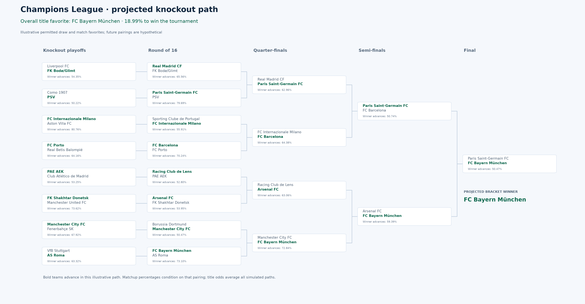

# Football standings prediction


*La Liga 2026/27 snapshot, generated October 11, 2026 at 00:24 UTC. Results through October 10, 2026 at 19:00 UTC; 73 completed fixtures, 10,000 simulations, fixed calibrated weights and no odds.*

*The [suspended Rayo–Athletic fixture](https://www.athletic-club.eus/en/news/2026/10/10/the-athletic-club-squad-returns-to-bilbao/) remains unresolved and is simulated from kickoff.*

A Python package for estimating every team's final league-position probabilities. The implementation lives in `src/standing_prediction`; the CLI and notebook call the same pipeline.

## Website

`site/` is a static, dependency-free page (dark "scoreboard" design; see [DESIGN.md](DESIGN.md)) showing the latest standings forecast for the top five leagues and the Champions League, including the projected knockout bracket. It reads the JSON in `site/data/`, and GitHub Actions deploys it to GitHub Pages on every push to `main` that touches `site/`.

To refresh the published numbers, rerun all six forecasts and rebuild the data, then commit `site/data`:

```bash
pip install -e . -e packages/champions-league
scripts/refresh_site.sh
```

A competition whose run fails keeps its previous outputs in `out/site`, so the site shows its last good forecast. Preview locally with `python3 -m http.server -d site 8000`.

## Champions League


*2026/27 forecast as of October 10, 2026 at 21:30 Toronto time (October 11 at 01:30 UTC): 18 played UCL fixtures, 11,165 domestic and European results, 10,000 simulations, fixed global weights and no odds. All 36 clubs have domestic history.*



[Download bracket (PDF)](docs/champions-league-bracket.pdf)

**Bayern München is the title favorite at 18.99%.** The bracket shows one permitted draw from projected league standings, advancing each matchup's favorite. Its pairings are illustrative until the real draw; title probabilities average all simulated draws and results.

Install and run the separate [Champions League package](packages/champions-league/README.md):

```bash
pip install -e . -e packages/champions-league
football-ucl --season 2026 --n-sim 10000
```

Open `out/cl_forecast.html` for the standings, bracket, stage probabilities and coverage report. Saved snapshot: [positions](docs/champions-league-positions.csv), [qualification/title probabilities](docs/champions-league-summary.csv), [club coverage](docs/champions-league-coverage.csv), and [provenance](docs/champions-league-metadata.json).

Some secondary domestic sources stop on September 19–20, and Czech 2025/26 history is missing. Sparse-country estimates are sensitive to league-strength priors; the summary includes title-probability sensitivity ranges. The official coefficients feed returned HTTP 403; unresolved simulated disciplinary ties use a seeded random fallback, and completed league phases use official ranks. Probabilities condition on fitted strengths and are not calibrated tournament confidence levels.

[Historical checks](docs/champions-league-evaluation.json) cover 18 forecast origins in 2024/25–2025/26 and 306 subsequent matches. Country offsets improve aggregate match log loss over the no-offset and Elo comparisons; a goals-only fit beats the fixed xG blend in this replay. The saved global weights remain unchanged. See [per-origin metrics](docs/champions-league-evaluation-snapshots.json) and [PLAN.md](PLAN.md) for the comparisons and limits.

## Inputs

- **Current season:** standings, completed scores, and the full fixture schedule from [football-data.org](https://www.football-data.org/).
- **Team history:** two prior seasons by default, primarily from [football-data.co.uk](https://www.football-data.co.uk/), with football-data.org as a fallback. Teams without observed history start at neutral strength.
- **xG:** match-level expected goals from [Understat](https://understat.com/) (top five leagues from 2014/15), joined to results by team pairing, kickoff (±2 days) and final score. Unmatched matches keep missing xG. Current-season xG is saved with every forecast; it changes the model only when `xg_weight > 0`.
- **Optional odds:** The Odds API or a saved odds CSV. Each observation must be timestamped before kickoff and available by the forecast origin. Undated historical odds are excluded.

## Methods

1. Fit a **Dixon–Coles goal model**, with recent matches weighted more heavily and a correction for low-scoring results.
2. Fit **Elo ratings**, accounting for home advantage and regressing ratings toward average strength between seasons.
3. Blend available model/market probabilities in **log space**, using fixed global weights from the stored multi-league calibration. Explicit overrides and optional outcome calibration remain available.
4. Simulate remaining **scorelines**, update points and goals, and rank teams using league sporting rules. La Liga uses head-to-head criteria and reapplies rules to remaining tied subsets.

Goal rates support two adjustments:

- **xG** (`xg_weight`): fits time-decayed attack/defense strengths to xG and blends them with the goal-based strengths: `log(rate) = (1 − w)·log(goal rate) + w·log(xG rate)`. Its default is read from the global calibration. The goal model's intercept and home advantage are kept, so league scoring stays on the goal scale.
- **Head-to-head** (`h2h_weight`, off by default): for each pair, the recency-weighted mean of past results relative to a model fitted only on earlier matches, shrunk toward zero. The home rate is shifted up and the away rate down by `h2h_weight ×` that effect. This is separate from La Liga's head-to-head ranking rules, which always apply.

## Outputs

`out/pd_position_probs.html` shows the colored chart first, sorted by each team's most likely finishing position, with average position breaking ties. Two-decimal percentages and a continuous nonlinear scale make small probabilities easier to distinguish. CSVs contain position probabilities and a summary of expected points/position, point percentiles, and title/top-four/bottom-three probabilities. JSON records the cutoff, odds coverage, model settings, and seed.

Input snapshots and each forecast are archived under `out/snapshots/pd/<season>/<timestamp>/`. Point intervals are conditional on fitted team strengths; `*_mc_se_pp` measures simulation sampling error in percentage points, not model error.

## Customize

Use keyword arguments with `run_prediction`, or the corresponding CLI flags (`prior_seasons` → `--prior-seasons`).

| Argument | Default | Controls |
| --- | --- | --- |
| `competition` | `"PD"` | `PD`, `PL`, `BL1`, `SA`, or `FL1` |
| `season` | `None` | Season start year; inferred using a July boundary |
| `n_sim`, `seed` | `10000`, `7` | Simulation count and reproducibility |
| `prior_seasons`, `xi` | `2`, `0.003` | History length and daily time decay |
| `weights` | Stored global calibration | Log-space blend; renormalized across available components |
| `use_odds`, `calibrate` | `True`, `False` | Optional market data and historical calibration |
| `max_goals`, `lambda_reg` | `10`, `0.1` | Score-grid limit and model regularization |
| `xg_weight` | Stored global calibration | Weight of xG strengths in log goal rates (0–1); `0` disables |
| `h2h_weight`, `h2h_seasons` | `0`, `6` | Log-rate shift per goal of head-to-head residual; seasons of past meetings |
| `out_dir` | `"out"` | Output directory |

```python
from dotenv import load_dotenv
from standing_prediction.predict_positions import run_prediction

load_dotenv()
forecast = run_prediction(competition="PD", season=None, n_sim=10000, use_odds=False)
forecast.probabilities
forecast.summary
```

## Run

Requires Python 3.11+. From the repository root:

```bash
python3 -m venv .venv
source .venv/bin/activate
pip install -e .
cp .env.example .env
# Set FOOTBALL_DATA_API_KEY in .env; ODDS_API_KEY is optional.
football-predict --competition PD
```

For the notebook: `pip install -e '.[notebook]'`, then `jupyter lab notebooks/laliga_prediction.ipynb`.

For historical evaluation: `football-backtest --competition PD --seasons 2022 2023 2024 --cutoffs 5 10 20 30`. Cutoffs count matches chronologically to approximate rounds; calibration uses only earlier evaluated seasons. Use `--help` for all options.

To compare the xG and head-to-head adjustments, run `football-ablation --competition PD --tune-seasons 2016 2017 2018 2019 --eval-seasons 2020 2021 2022 2023 2024 2025`. It picks weights by match log loss on the tuning seasons, freezes them, and then scores baseline, xG only, H2H only, and both on the evaluation seasons with identical origins and seeds.

Tests: `pip install -e '.[test]'`, then `pytest`.

## Global calibration

The separate [forecast-calibration package](packages/forecast-calibration/README.md) fits one set of main/odds/Elo weights and the xG weight across the top five leagues in 2015/16–2025/26. Every league-season contributes equally, and both quoted and unquoted forecasts enter the objective. The latest two seasons form a chronological holdout; leave-out folds measure stability, and six additional leagues check transfer without entering the fit.

Forecasts read `src/standing_prediction/calibrated_weights.json`, included in the installed package, and record its version in metadata. They do not refit these defaults per league, season or forecast. To explicitly rebuild and version them:

```bash
pip install -e . -e packages/forecast-calibration
football-calibrate --weights-out src/standing_prediction/calibrated_weights.json
```

Historical quote times and xG availability are approximated and labeled in the artifact. Backtests using these defaults on calibration seasons are retrospective; use the artifact's chronological holdout for the held-out comparison. Use `--weights main=0.35,odds=0.55,elo=0.10 --xg-weight 0` to reproduce the previous baseline.

## Limits

Point intervals exclude uncertainty in fitted strengths and future squad changes. Optional outcome recalibration has not consistently improved held-out scores. Global blend calibration measures match forecasts, so it does not establish that standings probabilities are calibrated. Fair-play criteria and deciding playoffs, including Serie A exceptions, are not simulated. Historical tables exclude disciplinary deductions and appeals; completed-season prediction exports use official positions. Top-four/bottom-three probabilities describe positions, not automatic qualification or direct relegation. In-progress fixtures are simulated from kickoff with a warning.

See [PLAN.md](PLAN.md) for the next priorities.
