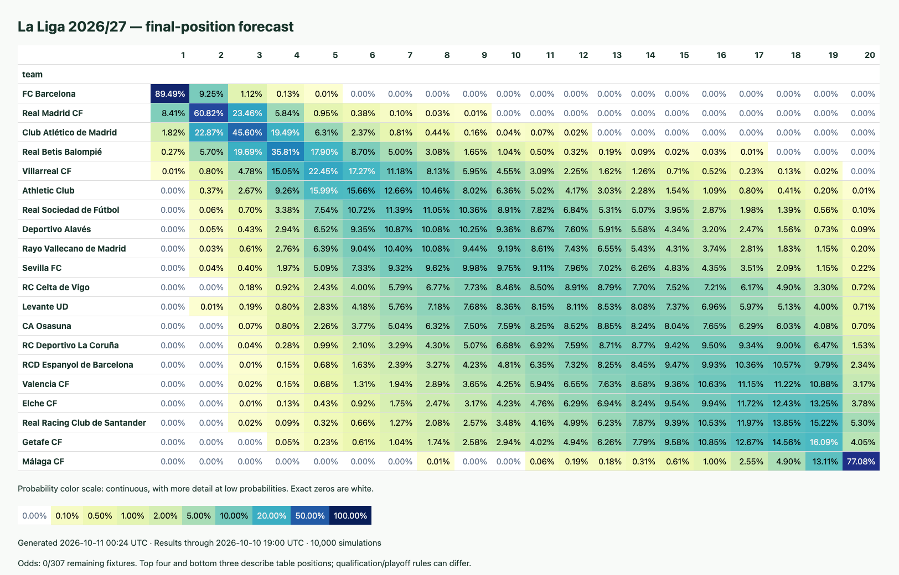
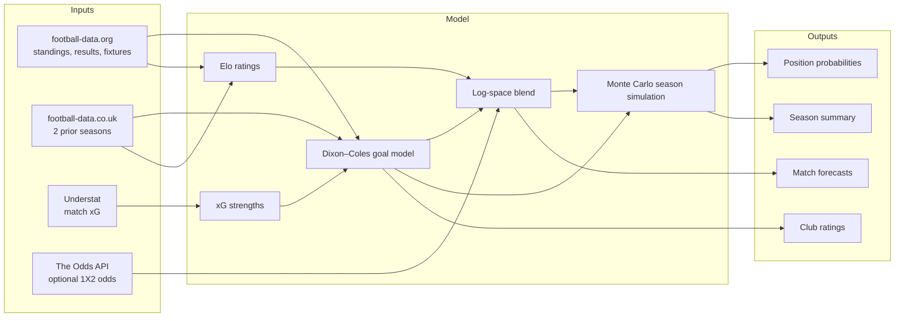
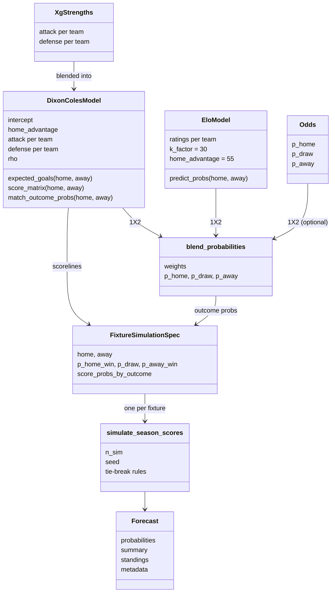
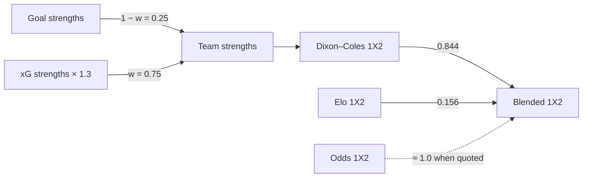
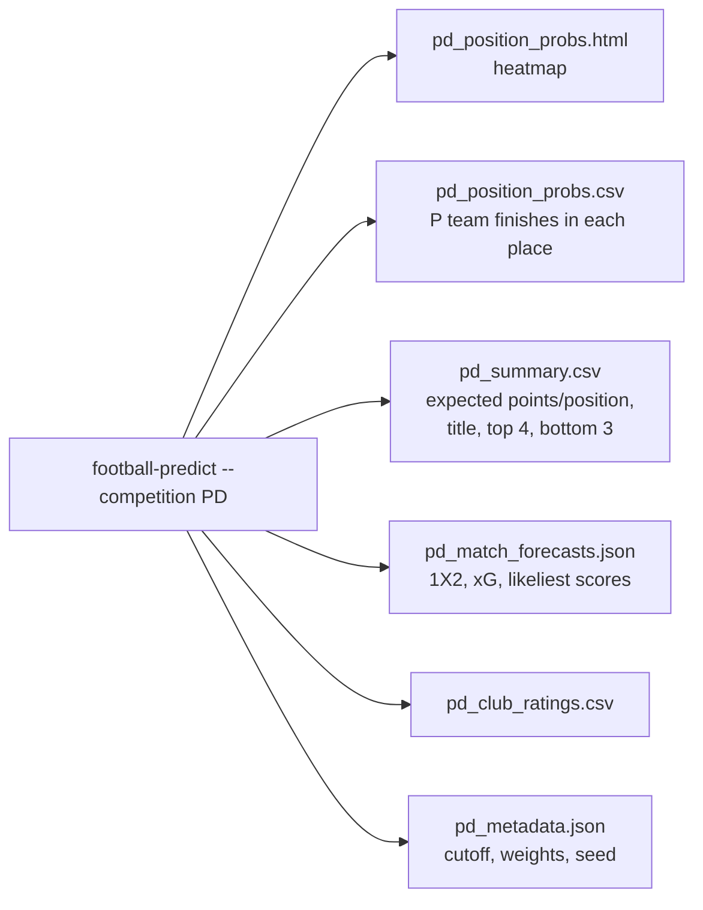
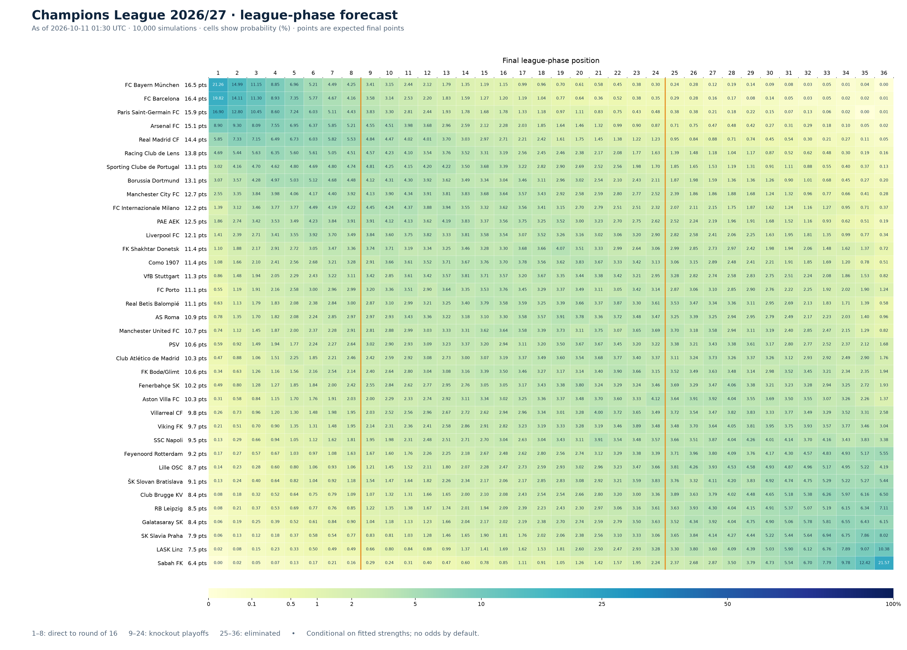

# Floodlight: football forecasts

**[Open Floodlight →](https://hediblk.github.io/football-predictions/)**

Floodlight is a website with forecasts for the Premier League, La Liga, Bundesliga, Serie A, Ligue 1 and the Champions League, refreshed every night at 01:17 UTC.

- **Tables:** each club's chance of finishing in every place, with title, top-four and relegation odds and a chart of how they have moved this season. The Champions League page covers the league phase and the knockout bracket.
- **Matches:** each day's fixtures with home, draw and away probabilities and likeliest scores, what's at stake in each game (title, top four and relegation; in the Champions League, the top eight, the top 24 and the trophy), and whether the model called past results.
- **Clubs:** a strength ranking of every club in the five leagues and the Champions League on one European scale, with weekly movement and a profile per club.
- **Model:** how the forecasts and ratings are made.

This repository holds both the site (`site/`, see [Website](#website)) and the model behind it (`src/standing_prediction` and `packages/`). The rest of this README describes the model.

## The model



*La Liga 2026/27, generated October 11, 2026: 73 completed fixtures, 10,000 simulations, calibrated weights, no odds.*

The model estimates every team's final league-position probabilities. It rates each team from past results, forecasts every remaining match, then plays out the rest of the season thousands of times and counts where each team finishes.

The code lives in `src/standing_prediction`; the CLI, notebook and website all call the same pipeline.

## How it works



1. **Rate teams.** A Dixon–Coles model fits each team's attack and defence from goals, weighting recent matches more (daily decay `xi = 0.003`) and correcting for low scores. Attack and defence are then blended with the same ratings fitted to xG. An Elo model rates teams from results alone.
2. **Forecast matches.** Each model gives home/draw/away probabilities. They are combined as a weighted geometric mean (a blend in log space) with fixed weights.
3. **Simulate.** For every remaining fixture, draw a result from the blended probabilities and a scoreline from the goal model within that result. Update points and goals, rank with the league's tie-breakers (La Liga uses head-to-head), repeat 10,000 times.

## Components



| Component | File | Role |
| --- | --- | --- |
| Dixon–Coles | `dixon_coles.py` | Expected goals and scoreline probabilities per fixture |
| xG strengths | `xg.py` | Attack/defence fitted to Understat xG |
| Elo | `elo.py` | Result-based ratings, regressed toward average each season |
| Odds | `odds.py` | De-margined bookmaker probabilities, only if quoted before the forecast time |
| Blend | `ensemble.py` | Weighted geometric mean of the available models |
| Simulation | `simulate.py` | Plays out the season and applies league tie-breakers |
| Pipeline | `predict_positions.py` | Fetches data, fits models, writes outputs |

## Weights



| Weight | Value | Meaning |
| --- | --- | --- |
| `xg_weight` | 0.75 | Share of each team's strength taken from xG |
| `xg_scale` | 1.3 | Stretches xG strengths; xG understates the gap between strong and weak teams |
| `main` / `elo` (no odds) | 0.844 / 0.156 | Blend of Dixon–Coles and Elo |
| `odds` | ≈ 1.0 | When odds exist, the market dominates the blend |
| `xi` | 0.003 | Daily time decay (a match a year old counts about one third) |
| `lambda_reg` | 2 | Ridge penalty on team strengths |
| `h2h_weight` | 0 | Head-to-head adjustment, off |

Weights are renormalized over the models available for a fixture, so without odds the blend is 84% Dixon–Coles and 16% Elo. The website runs without odds.

They come from one global fit across the top five leagues, 2015/16–2025/26, stored in `src/standing_prediction/calibrated_weights.json` (version `global-4c0170be18f1`). Forecasts never refit them. To rebuild them, see the [forecast-calibration package](packages/forecast-calibration/README.md).

## Outputs



Files go to `out/`, and each run is archived under `out/snapshots/<competition>/<season>/<timestamp>/`. Played matches are forecast from data before their match day, so the model's record never sees the result it is judged on.

## Run

Requires Python 3.11+ and a free [football-data.org](https://www.football-data.org/) API key.

```bash
python3 -m venv .venv
source .venv/bin/activate
pip install -e .
cp .env.example .env   # set FOOTBALL_DATA_API_KEY; ODDS_API_KEY is optional
football-predict --competition PD
```

Competitions: `PL`, `PD`, `BL1`, `SA`, `FL1`. Common flags: `--n-sim`, `--seed`, `--season`, `--no-use-odds`, `--out-dir`; `--help` lists the rest. `--as-of 2026-09-15T05:30:00Z` reruns the forecast as it would have been made then: results count from kickoff plus three hours, later ones go back to scheduled, and the table is rebuilt from the rest with the league's tie-breaks (point deductions in today's table are carried back, since the feed does not date them).

From Python:

```python
from dotenv import load_dotenv
from standing_prediction.predict_positions import run_prediction

load_dotenv()
forecast = run_prediction(competition="PD", n_sim=10000, use_odds=False)
forecast.probabilities
```

Other commands:

- `football-backtest --competition PD --seasons 2022 2023 2024`: score past forecasts.
- `football-ablation --competition PD ...`: compare the xG and head-to-head adjustments.
- `pytest` (after `pip install -e '.[test]'`).
- Notebook: `pip install -e '.[notebook]'`, then open `notebooks/laliga_prediction.ipynb`.

For the pinned CI environment, use Python 3.12 and install both model packages:

```bash
python -m pip install -r requirements-lock.txt
python -m pip install -c requirements-lock.txt -e '.[test]' -e packages/champions-league
PYTHONDONTWRITEBYTECODE=1 PYTHONHASHSEED=0 OPENBLAS_NUM_THREADS=1 OMP_NUM_THREADS=1 python -m pytest -q
python scripts/validate_site_data.py --data site/data
python -m playwright install chromium
python scripts/check_site.py --site site
```

Model/shared changes run the offline test suite; site/shared changes validate published data and load every view in headless Chromium (`scripts/check_site.py`, [ADR 0002](docs/adr/0002-site-browser-checks.md)). Daily refresh stages fresh and retained files together before validation, and deployment checks out, validates, versions the asset URLs of (`scripts/stamp_assets.py`) and browser-checks the exact build uploaded to Pages. Numerical baseline updates are deliberate; see [numerical protection](docs/numerical-protection.md) and the [data contract](docs/site-data-contract.md).

## Champions League



A separate package forecasts the 36-team league phase and the knockout bracket. It fits one model across domestic and European results, with country offsets to compare leagues; offsets with little European evidence shrink toward a typical league level, and archived bookmaker prices for Champions League games set each league's current level. See the [Champions League README](packages/champions-league/README.md).

```bash
pip install -e . -e packages/champions-league
football-ucl --season 2026 --n-sim 10000
```

## Website

`site/` is [Floodlight](https://hediblk.github.io/football-predictions/), a static page with the four tabs described at the top. The [site workflow](.github/workflows/site.yml) reruns all six forecasts daily at 01:17 UTC, commits `site/data` and redeploys GitHub Pages. It also archives daily bookmaker odds, including the Europa and Conference League, to [data/odds](data/odds/README.md); the Champions League model reads the archived Champions League prices, and the rest are kept for model-versus-market comparisons and later tests.

Each refresh also keeps dated snapshots in `site/data/history/<season>/`, for charts and the weekly club ranking. `<competition>.json` holds every club's title, top-four and relegation chances (Champions League: stage chances), with one point per day that brings new results; a refresh without new results updates the latest point. `clubs.json` freezes every rated club's overall, attack and defence ratings once a week, at the Monday refresh (or Tuesday's if Monday's failed), after the weekend round and the previous week's Champions League games. The Clubs tab ranks clubs on the live ratings and uses the previous Monday's freeze only for the movement arrows. `scripts/backfill_history.py` fills earlier days by rerunning the forecasts with `--as-of` at 05:30 UTC on each past day; it resumes where it stopped and keeps points the refresh added later.

Fresh exports also save the published pre-kickoff match forecasts in `history/<season>/forecasts/<competition>.json`. Each receipt can update until kickoff, then freezes. Finished games use these saved numbers where available and label other forecasts as reconstructed; receipts are never backfilled or updated by a failed competition refresh.

After exports, `scripts/fetch_match_events.py` fetches Understat shots and player rows for finished domestic fixtures, plus ESPN box scores and timelines for all six competitions, into the shared `site/data/match/<season>/<competition>/<fixture id>.json`. The next refresh fills the current season once, at one request per second, and retries missing data through seven days after kickoff. Published sources are never refetched; raw payloads stay in `.cache/`. Score or xG mismatches produce warnings and omit that source. After mode uses these data for Chances, Match stats and goal/card markers; Before mode keeps the pre-match forecast. The [data contract](docs/site-data-contract.md) describes the fields and the retrospective independent-shot probabilities; these data never change forecasts. To check ingestion locally, copy `site/data` into an `out/` directory and pass `--src out/site --data out/<candidate>`; `--provider espn` limits ingestion to ESPN.

Club ratings come from the Champions League model, which puts every club on one European scale. A rating is the share of points a club would take off an average European top-flight side on a neutral pitch; the average is taken over every club with domestic results in the past year (about 330 clubs in 17 leagues). Leagues compare through European cup matches between clubs from different countries, with each league's current level set by archived Champions League prices, so no outside league ratings are needed. `football-ucl` writes the ratings to `cl_club_ratings.csv`. The Clubs tab ranks every club in the five leagues plus the Champions League clubs from elsewhere; their pages follow their Champions League season.

Refresh by hand and preview:

```bash
scripts/refresh_site.sh
python3 -m http.server -d site 8000
```

## Data quirks

- **Cancelled** fixtures are simulated as if they will be replayed; `--strict-fixtures` makes them an error.
- **Awarded** results count as played. Official decisions without a score go in `fixture_overrides.csv`.
- **Lagging** results, where the table already counts a match still listed as unplayed, take their score from Understat.

`fixture_overrides.csv` columns: `competition,season,home_team,away_team,status,home_goals,away_goals,note`, with `status` either `FINISHED` (with the score) or `SCHEDULED`, using football-data.org team names.

Every adjustment is logged and listed in the forecast metadata.

## Limits

- Probabilities assume the fitted team strengths are right; they ignore rating uncertainty, transfers and injuries.
- Weights are calibrated on match forecasts, not on final standings.
- Fair-play tie-breakers and deciding playoffs are not simulated.
- "Top four" and "bottom three" are positions, not qualification or relegation.

See [ROADMAP.md](ROADMAP.md) for what is next, [PLAN.md](PLAN.md) for model design history, and [CONTEXT.md](CONTEXT.md) for terminology. Architectural decisions live in [docs/adr/](docs/adr/), including the accepted [site/model boundary](docs/adr/0001-site-model-boundary.md).
